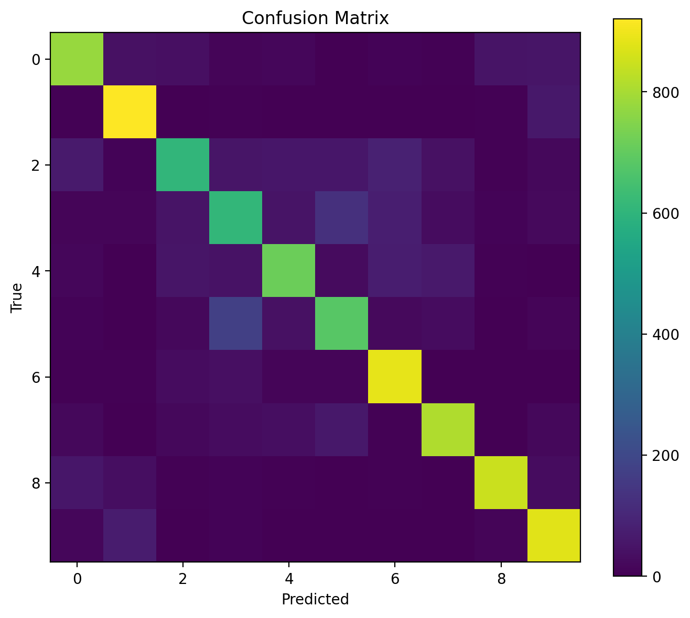

# CIFAR-10 CNN Classifier

A Convolutional Neural Network for CIFAR-10 image classification, built using PyTorch. This project covers the complete pipeline from data preprocessing and hyperparameter tuning to model evaluation and interactive image inference through Streamlit.

**Test Accuracy:** 77.44%  
**Best Validation Accuracy:** 72.70%  
**Test Loss:** 0.6587

---

## What It Does

- Classifies 32×32 RGB images into 10 CIFAR-10 categories
- Implements a custom CNN architecture using PyTorch
- Applies image augmentation and normalization
- Performs hyperparameter tuning across learning rate, batch size, and dropout
- Selects the best model based on validation accuracy
- Evaluates performance on the CIFAR-10 test set
- Generates class-wise accuracy, classification reports, and confusion matrices
- Provides an interactive Streamlit application for image inference
- Displays Top-3 predictions, confidence scores, and class probabilities

---

## Tech Stack

| Component | Tool |
|---|---|
| Deep Learning Framework | PyTorch |
| Dataset | CIFAR-10 |
| Image Processing | Torchvision |
| Numerical Computing | NumPy |
| Data Analysis | Pandas |
| Evaluation Metrics | Scikit-learn |
| Visualization | Matplotlib |
| Web Application | Streamlit |

---

## Project Structure

```text
cifar10-cnn-classifier/
├── app/
│   ├── app.py                  # Streamlit inference interface
│   └── model.py                # Application model definition
├── data/                       # CIFAR-10 dataset (not tracked)
├── models/
│   └── cifar10_cnn_best.pth    # Best trained model checkpoint
├── notebooks/
│   └── 02_training.ipynb       # Training experimentation
├── results/
│   ├── best_config.json        # Selected hyperparameters
│   ├── confusion_matrix.png    # Normalized confusion matrix
│   ├── training_curves.png     # Training and validation curves
│   └── tuning_results.csv      # Hyperparameter tuning results
├── src/
│   ├── model.py                # CNN architecture
│   ├── data.py                 # Data loading and preprocessing
│   ├── train.py                # Training and validation pipeline
│   ├── tune.py                 # Hyperparameter tuning
│   ├── evaluate.py             # Test evaluation and reporting
│   └── utils.py                # Utility functions
├── requirements.txt
├── .gitignore
└── README.md
```

---

## Dataset

The project uses the [CIFAR-10 dataset](https://www.cs.toronto.edu/~kriz/cifar.html).

CIFAR-10 consists of 60,000 RGB images of size 32×32 pixels, distributed across 10 classes.

| Split | Images |
|---|---:|
| Training | 50,000 |
| Testing | 10,000 |
| Total | 60,000 |

**Classes:** Airplane, Automobile, Bird, Cat, Deer, Dog, Frog, Horse, Ship, Truck.

### Preprocessing

- Random horizontal flipping
- Random cropping with padding
- Tensor conversion
- Normalization using CIFAR-10 mean and standard deviation
- Reproducible train-validation split using a fixed random seed

---

## Model Architecture

The CNN consists of two convolutional blocks followed by fully connected layers.

| Layer | Configuration |
|---|---|
| Convolutional Block 1 | Conv2d (3 → 32) + BatchNorm + ReLU + MaxPool |
| Convolutional Block 2 | Conv2d (32 → 64) + BatchNorm + ReLU + MaxPool |
| Fully Connected Layer | 64 × 8 × 8 → 256 |
| Dropout | 0.2 |
| Output Layer | 256 → 10 |

**Training Configuration:**

- Loss Function: CrossEntropyLoss
- Optimizer: Adam
- Learning Rate: 0.001
- Batch Size: 64
- Dropout: 0.2

---

## Hyperparameter Tuning

A manual grid search was conducted across:

| Hyperparameter | Values |
|---|---|
| Learning Rate | 0.01, 0.001, 0.0001 |
| Batch Size | 32, 64 |
| Dropout | 0.2, 0.5 |

Each configuration was trained for a reduced number of epochs during tuning. The best configuration was selected based on validation accuracy.

### Best Configuration

| Parameter | Value |
|---|---:|
| Learning Rate | 0.001 |
| Batch Size | 64 |
| Dropout | 0.2 |
| Best Validation Accuracy | 72.70% |

Tuning outputs:

- `results/tuning_results.csv`
- `results/best_config.json`

---

## Evaluation Results

The selected model checkpoint was evaluated on the 10,000-image CIFAR-10 test set.

### Overall Performance

| Metric | Result |
|---|---:|
| Test Accuracy | 77.44% |
| Test Loss | 0.6587 |
| Macro F1-score | 0.77 |
| Weighted F1-score | 0.77 |

### Class-wise Accuracy

| Class | Accuracy |
|---|---:|
| Automobile | 92.10% |
| Frog | 88.80% |
| Truck | 88.10% |
| Ship | 84.80% |
| Horse | 81.30% |
| Airplane | 77.90% |
| Deer | 71.50% |
| Dog | 68.30% |
| Cat | 61.00% |
| Bird | 60.60% |

### Confusion Matrix



The evaluation pipeline also generates a classification report containing precision, recall, and F1-score for each class.

---

## Streamlit Application

The repository includes an interactive Streamlit application for image inference.

### Features

- Upload an image for classification
- Display the predicted CIFAR-10 category
- Show Top-3 predictions
- Display confidence scores
- Visualize class probability distributions

### Run Locally

```bash
streamlit run app/app.py
```

The application loads the trained model checkpoint from `models/cifar10_cnn_best.pth`.

---

## Setup

**1. Clone the repository**

```bash
git clone https://github.com/Saiful-Codes/cifar10-cnn-classifier.git
cd cifar10-cnn-classifier
```

**2. Create a virtual environment**

```bash
python -m venv env
```

Activate the environment:

```powershell
.\env\Scripts\Activate.ps1
```

**3. Install dependencies**

```bash
pip install -r requirements.txt
```

**4. Run the Streamlit application**

```bash
streamlit run app/app.py
```

The CIFAR-10 dataset is downloaded automatically through Torchvision when required.

---

## Training and Evaluation

**Train the model**

```bash
python -m src.train
```

**Run hyperparameter tuning**

```bash
python -m src.tune
```

**Evaluate the trained model**

```bash
python -m src.evaluate
```

---

